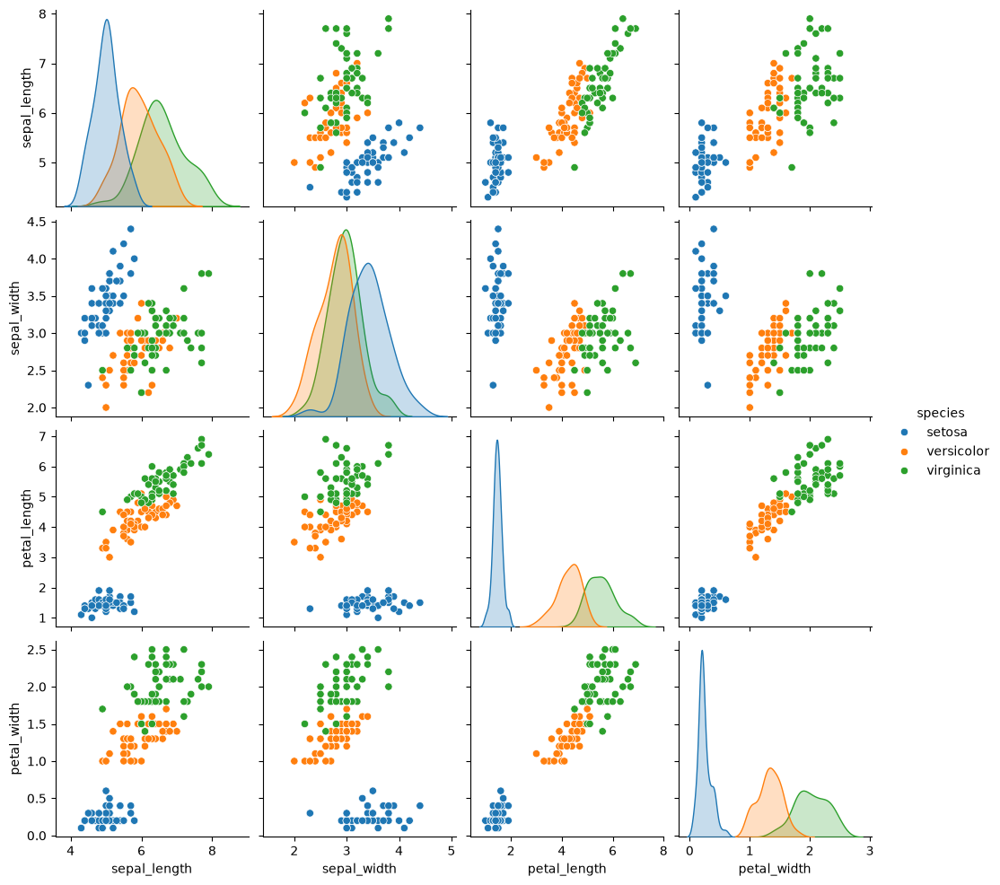
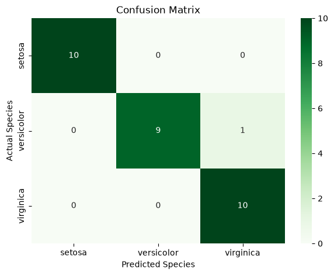
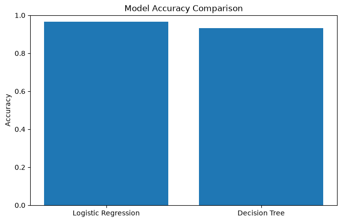
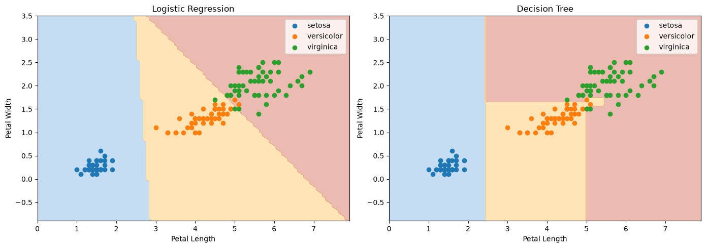

# Multi-Class Benchmark Classification Pipeline Using the Iris Dataset

**Internship:** Datheon – Task 1  
**Domain:** Machine Learning  
**Project Type:** Supervised Learning – Multi-Class Classification

## About the Project

This project focuses on building a multi-class classification pipeline using the Iris dataset. Two machine learning algorithms, Logistic Regression and Decision Tree Classifier, are implemented and compared using different evaluation metrics.

The project demonstrates the basic workflow of a machine learning task, starting from dataset exploration and preprocessing to model training and performance evaluation.

## Objectives

- Explore and understand the Iris dataset.
- Perform data visualization and preprocessing.
- Train two machine learning classification models.
- Evaluate model performance using standard metrics.
- Compare the results of both models.

## Technologies Used

- Python
- Pandas
- NumPy
- Matplotlib
- Seaborn
- Scikit-learn
- Jupyter Notebook

## Machine Learning Algorithms

1. Logistic Regression
2. Decision Tree Classifier

## Evaluation Metrics

- Accuracy
- Precision
- Recall
- F1-score
- Classification Report
- Confusion Matrix

## Results

| Model | Accuracy |
|---|---:|
| Logistic Regression | 96.67% |
| Decision Tree | 93.33% |

Logistic Regression achieved better accuracy on this dataset.

## Project Workflow

1. Dataset loading and exploration
2. Data visualization
3. Data preprocessing
4. Train-test splitting
5. Model training
6. Model prediction
7. Model evaluation
8. Performance comparison
9. Decision boundary visualization

## Data Visualization

### 1. Iris Dataset Pairplot

This graph shows the relationships between different features of the Iris dataset.

### 2. Confusion Matrix

This visualization shows the classification performance of the model.

### 3. Model Accuracy Comparison

This graph compares the accuracy of Logistic Regression and Decision Tree.

### 4. Decision Boundary Visualization

This graph represents how the classification model separates different classes.

## Learning Outcomes

Through this project, I gained practical experience in:

- Understanding a classification problem.
- Preparing data for machine learning.
- Training classification algorithms.
- Evaluating model performance.
- Comparing machine learning models.

## Conclusion

This project provided practical experience in developing a supervised machine learning classification pipeline. The comparison showed that Logistic Regression performed better than the Decision Tree Classifier on the Iris dataset based on accuracy.
