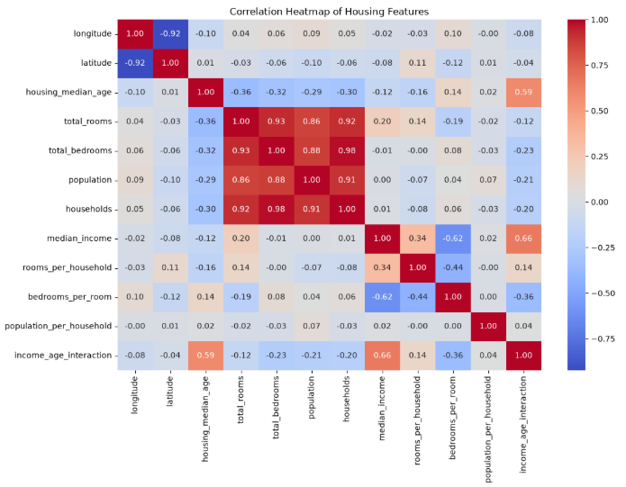
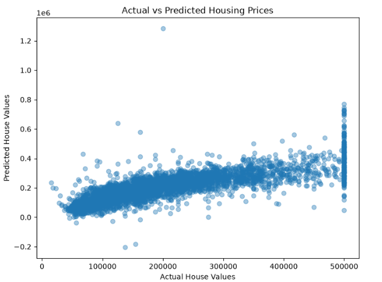
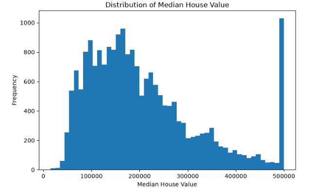
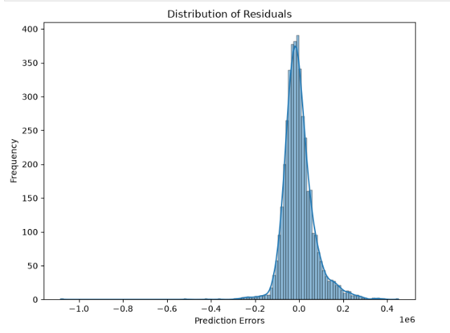
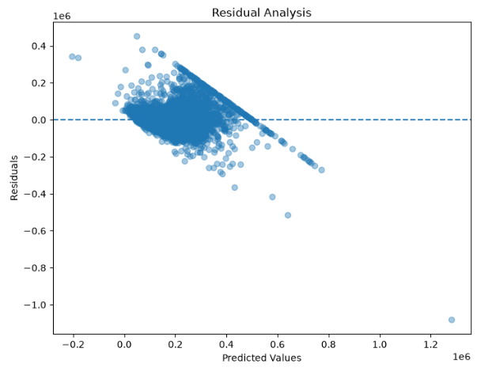

# Real Estate Housing Price Prediction Using Ridge and Lasso Regression

**Internship:** Datheon – Machine Learning & Data Science Internship  
**Task:** Task 2  
**Domain:** Machine Learning  
**Project Type:** Supervised Learning – Regression

---

## 1. About the Project

This project focuses on predicting house prices using Machine Learning regression algorithms. It uses the California Housing dataset and implements three regression models: Ordinary Least Squares (OLS), Ridge Regression and Lasso Regression.

The project demonstrates the complete machine learning workflow, starting from data exploration and preprocessing to model training, hyperparameter tuning and performance evaluation.

The main aim is to compare different regression models and identify the best-performing model for housing price prediction.

## 2. Objectives

- Explore and understand the housing dataset.
- Perform data cleaning and preprocessing.
- Handle missing values.
- Perform feature engineering.
- Apply categorical encoding and numerical feature scaling.
- Train OLS, Ridge and Lasso regression models.
- Perform hyperparameter tuning using GridSearchCV.
- Evaluate models using standard regression metrics.
- Compare model performance.
- Visualize actual and predicted house prices.

## 3. Dataset Description

**Dataset Name:** Housing.csv

The dataset contains 20,640 records and 10 original columns.

**Target Variable:** `median_house_value`

### Dataset Features

| Feature | Description |
|---|---|
| longitude | Longitude of geographical location |
| latitude | Latitude of geographical location |
| housing_median_age | Median age of houses |
| total_rooms | Total number of rooms |
| total_bedrooms | Total number of bedrooms |
| population | Population of the area |
| households | Number of households |
| median_income | Median income of the area |
| ocean_proximity | Proximity to the ocean |
| median_house_value | Median house value (target) |

The dataset contains 207 missing values in `total_bedrooms`. These missing values are handled using median imputation.

## 4. Technologies Used

- Python
- Jupyter Notebook
- Pandas
- NumPy
- Matplotlib
- Seaborn
- Scikit-learn

## 5. Machine Learning Algorithms

### 1. Ordinary Least Squares (OLS) Linear Regression

A basic linear regression model used as a baseline for predicting housing prices.

### 2. Ridge Regression

A regularized regression technique that uses L2 regularization to reduce the effect of large model coefficients.

### 3. Lasso Regression

A regularized regression technique that uses L1 regularization and can reduce some feature coefficients to zero.

## 6. Project Workflow

1. Dataset loading and exploration
2. Data inspection and statistical analysis
3. Missing-value analysis
4. Train-test splitting
5. Missing-value treatment using median imputation
6. Feature engineering
7. Correlation analysis
8. Categorical feature encoding
9. Numerical feature scaling
10. OLS, Ridge and Lasso model training
11. Model evaluation
12. Hyperparameter tuning using GridSearchCV
13. Model comparison
14. Actual vs Predicted visualization
15. Residual analysis
16. Final conclusion

## 7. Feature Engineering

The following additional features are created:

- `rooms_per_household`
- `bedrooms_per_room`
- `population_per_household`
- `income_age_interaction`

These features are created using existing numerical columns in the dataset.

## 8. Data Preprocessing

The following preprocessing techniques are used:

- Median imputation for missing numerical values.
- One-Hot Encoding for categorical features.
- StandardScaler for numerical feature scaling.
- Train-test splitting with an 80:20 ratio.

## 9. Hyperparameter Tuning

GridSearchCV is used to find suitable regularization parameters for Ridge and Lasso Regression.

The tuning process uses 5-fold cross-validation and negative Root Mean Squared Error as the scoring method.

## 10. Model Evaluation

The models are evaluated using the following metrics:

| Metric | Description |
|---|---|
| RMSE | Measures the square root of the average squared prediction error |
| MAE | Measures the average absolute prediction error |
| R² Score | Measures how well the model explains variation in house prices |

The model with the lowest RMSE is considered the best-performing model among the compared models.

## 11. Model Results

The performance of OLS, Ridge and Lasso Regression is compared using RMSE, MAE and R² Score.

The best-performing model is selected based on the lowest RMSE.

Actual evaluation values and best hyperparameters are available in the Jupyter Notebook.

## 12. Data Visualizations

### 1. Correlation Heatmap

This heatmap shows the correlation between different numerical housing features. It helps identify relationships between variables.

### 2. Actual vs Predicted Housing Prices

This scatter plot compares actual house prices with the prices predicted by the regression model.

### 3. Distribution of Median House Value

This histogram represents the distribution of median house values in the dataset.

### 4. Distribution of Residuals

This histogram shows the distribution of prediction errors (residuals) generated by the regression model.

### 5. Residual Analysis

This scatter plot represents residuals against predicted values and helps examine prediction errors.

## 13. Learning Outcomes

Through this project, I gained practical experience in:

- Understanding regression problems.
- Exploring and cleaning real-world datasets.
- Handling missing values.
- Performing feature engineering.
- Applying encoding and scaling techniques.
- Implementing OLS, Ridge and Lasso Regression.
- Performing hyperparameter tuning.
- Evaluating and comparing regression models.
- Understanding residual analysis and model performance.

## 14. Conclusion

This project provided practical experience in developing a complete Machine Learning regression pipeline for housing price prediction.

It helped demonstrate the importance of data preprocessing, feature engineering, regularization techniques and hyperparameter tuning.

The comparison of OLS, Ridge and Lasso Regression helped in understanding how different regression algorithms perform on the housing dataset.

## 15. Project Information

**Project:** Real Estate Housing Price Prediction  
**Internship:** Datheon – Machine Learning & Data Science Internship  
**Task Number:** Task 2  
**Author:** Sanika Ganesh Awate  
**Course:** B.Sc. Data Science
